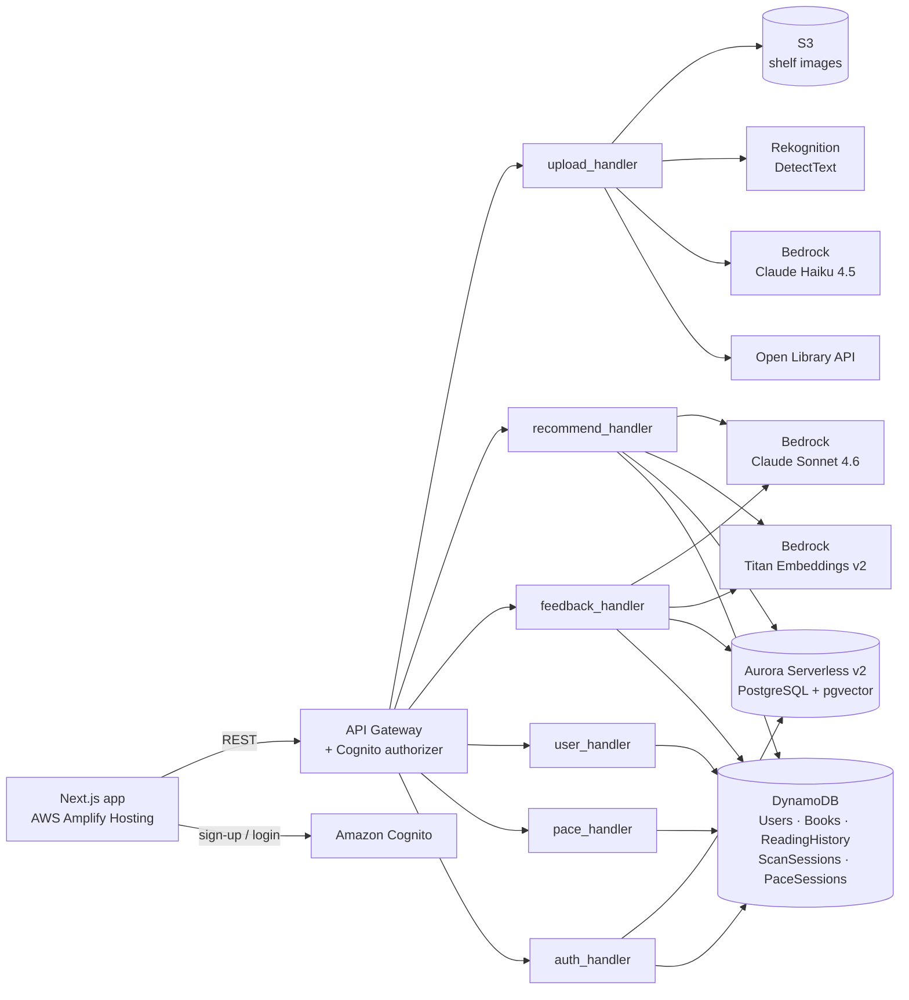

# ShelfScannerAI

**Photograph a bookshelf. Get your next read, and why.**

ShelfScannerAI is a serverless AWS app that turns a photo of a bookshelf into personalized, explainable book recommendations. It reads the spines, figures out which books are actually there, and ranks them against *your* reading taste with plain-English reasons and an estimate of how long each one will take you to finish.

**Live demo:** https://main.d3e1l3syrof2p7.amplifyapp.com

---

## The problem

You're in a library or bookstore holding a stack of books you've never heard of, with five minutes to decide. Existing apps make you search each title by hand, read reviews from strangers, and get genre-based suggestions that ignore what you actually like.

ShelfScannerAI does it in three steps:

1. **Photograph the shelf.** Titles and authors are extracted automatically.
2. **Match against your taste.** Each book is compared to what you've read and liked before, or to your stated preferences if you're new.
3. **Get ranked picks with reasons.** For example: *"Similar to Dreamcatcher, which you rated 5/5; about 6 hours at your pace."*

## Features

- **Photo to library.** Scan up to 3 photos at once. OCR with Amazon Rekognition, cleaned up by an LLM that groups text fragments into real title and author pairs, then enriched with Open Library metadata. Books caught in more than one photo are merged.
- **Chat with your reading companion.** No photo? Type the books you're torn between ("Pet Sematary or Hill House?") or describe a mood ("something creepy under 300 pages"). Claude Sonnet uses tools to look each book up and score it against your history, then answers conversationally, with follow-up questions supported.
- **Explainable recommendations.** Vector similarity against your own reading history (pgvector), ranked and explained by Claude on Amazon Bedrock.
- **Works from day one.** New users get recommendations matched against a curated 445-book catalog, narrowed to their onboarding preferences.
- **"Go with preference" or "Try something new."** Ask for the closest match to your taste, or deliberately for something outside it. Genres you've said you dislike are always filtered out.
- **Taste that learns.** Write a sentence about a book you finished, and Claude extracts liked and disliked elements into your taste profile.
- **Reading pace.** A session timer computes your pages per hour, and every recommendation shows an estimated time to finish.
- **Accounts that keep your guest history.** Sign up with Amazon Cognito and anything you did as a guest (profile, history, pace sessions, scans) moves into your account.
- **A personalized profile page.** An animated 3D book flips its pages while your own genres and authors drift up off them, tinted by your genre. It respects the system's reduced-motion setting.

## Architecture



All infrastructure is defined in one AWS SAM template ([backend/template.yaml](backend/template.yaml)): 7 Python 3.12 Lambdas, 5 DynamoDB tables, an Aurora Serverless v2 cluster accessed through the RDS Data API (no VPC or connection pooling needed in Lambda), an S3 bucket, and a Cognito user pool.

### How a recommendation is made

1. **Upload.** The image goes to S3. Rekognition `DetectText` caps out at 100 words per call, so dense shelves are recursively split into overlapping slices until each slice fits under the cap.
2. **Consolidate.** Raw OCR lines (titles mixed with author names, blurbs, publisher marks and ISBNs) go to Claude Haiku in one batch, which returns only real title and author pairs.
3. **Enrich.** Each pair is looked up in Open Library for page count and genres.
4. **Retrieve.** Candidates are embedded with Titan v2 and compared with pgvector cosine distance against:
   - **Established users:** embeddings of books they've finished and reviewed.
   - **New users:** a 15-book subset of the curated catalog that matches their onboarding preferences.
5. **Rank and explain.** Claude Sonnet receives the similarity signals plus the taste profile and writes the reasoning.

### How the chat agent works

`POST /chat` runs a Claude Sonnet tool-use loop on the same Lambda as `/recommend`, so both share one matching engine. The model sees the reader's taste profile, pace, and finished books with ratings, and can call two tools:

- **`evaluate_books`** looks up each named book on Open Library, embeds it, and scores it against the reader's history. It also flags books the reader has already read and genres they dislike.
- **`search_catalog`** finds books matching an open-ended description in the catalog, then scores those the same way.

Book lookups run in parallel. As with scans, the model never supplies numbers: only books a tool actually evaluated in that turn can appear as pick cards, and their match scores and reading times come from the tool results. The backend is stateless; the client sends recent turns, including which books were shown, so follow-ups like "which of those is shortest?" work. Ordering, filtering and time estimates stay in Python. The model's output is checked against the candidates that were actually sent, results are sorted by match score in code, and `estimatedHours` (page count ÷ pages per hour) is computed in Python rather than by the model.

## Engineering highlights

Problems found by testing on real data, and how they were solved:

| Problem | Solution |
|---|---|
| A real 16-book photo produced 38 "titles," only about 7 of them correct. Rekognition reads every line on a spine, and Open Library fuzzy-matches anything. | An LLM consolidation step between OCR and lookup. Result: 14-15 of 16 books found with zero false positives. |
| Books at the top and bottom of a dense stack went missing. | Traced to Rekognition's silent 100-word limit per call; fixed with adaptive, overlapping image slicing. |
| Recommendations appeared out of order next to their match-percentage badges. | Stopped relying on the LLM's own rank field and sort by score in code. |
| User IDs were trusted blindly from the request body. | Added Cognito auth: a parallel set of `/me/...` routes behind API Gateway's built-in Cognito authorizer, using the same Lambda code with no business logic duplicated. |
| A guest who signs up would lose their history. | An idempotent `/me/claim` migration that re-keys data across 4 DynamoDB tables and Aurora, merging profiles instead of overwriting them. |
| The RDS Data API rejects array parameters; DynamoDB rejects Python floats. | Store arrays as JSON text; convert all numbers with `Decimal` on write and `float()` on read. |

More detail, including every deployment bug found along the way, is in [ShelfScannerAI_Handoff.md](ShelfScannerAI_Handoff.md).

## Tech stack

| Layer | Technology |
|---|---|
| Frontend | Next.js 16 (App Router, static export), React 19, Tailwind CSS 4, TypeScript |
| Hosting | AWS Amplify Hosting |
| API | Amazon API Gateway (REST) with a Cognito user-pool authorizer |
| Compute | AWS Lambda (Python 3.12), AWS SAM |
| AI / ML | Amazon Rekognition, Amazon Bedrock (Claude Sonnet 4.6, Claude Haiku 4.5, Titan Text Embeddings v2) |
| Data | DynamoDB, Aurora Serverless v2 PostgreSQL + pgvector (via the RDS Data API), S3 |
| Auth | Amazon Cognito (email/password; PKCE flow ready for Google sign-in) |
| Testing | pytest + moto (backend), Jest + React Testing Library (frontend) |

## API

Every user-data route has a guest version (by `userId`) and a signed-in version under `/me/...`, which requires a Cognito ID token.

| Method | Guest route | Signed-in route | Purpose |
|---|---|---|---|
| POST | `/upload` | — | Shelf photo → extracted, enriched titles |
| POST | `/recommend` | `/me/recommend` | Ranked, explained recommendations |
| POST | `/chat` | `/me/chat` | Conversational agent: compare named books or ask open-ended |
| POST | `/feedback` | `/me/feedback` | Post-read feedback → taste profile update |
| GET | `/user/{userId}/profile` | `/me/profile` | Taste profile, history, pace stats |
| POST | `/user/{userId}/onboarding` | `/me/onboarding` | Seed preferences for new users |
| POST | `/user/{userId}/pace-log` | `/me/pace-log` | Log a timed reading session |
| POST | — | `/me/claim` | Move guest data into a new account |

## Project structure

```
backend/
  template.yaml          SAM template: all AWS infrastructure
  upload_handler/        OCR, LLM consolidation, Open Library enrichment
  recommend_handler/     vector retrieval + Claude ranking, and the /chat tool-use agent
  feedback_handler/      feedback → taste signals → embeddings
  user_handler/          profile + onboarding
  pace_handler/          reading sessions → rolling pages/hour
  auth_handler/          guest → account data migration
  db_bootstrap/          custom resource that creates the pgvector tables
  scripts/ingest_catalog.py   one-time load of the 445-book catalog
  tests/                 pytest + moto
frontend/
  app/                   routes: /, /scan, /ask, /profile, /login, /auth/callback
  components/            UI, including ReadingScene / ReaderProfile
  lib/                   API client, Cognito auth, backdrop generation
```

## Running it

### Frontend

```bash
cd frontend
npm install
cp .env.example .env.local   # fill in values from the backend stack outputs
npm run dev                  # http://localhost:3000
```

| Variable | Source |
|---|---|
| `NEXT_PUBLIC_API_BASE_URL` | `ApiBaseUrl` stack output |
| `NEXT_PUBLIC_COGNITO_REGION` | your AWS region |
| `NEXT_PUBLIC_COGNITO_USER_POOL_ID` | `UserPoolId` stack output |
| `NEXT_PUBLIC_COGNITO_CLIENT_ID` | `UserPoolClientId` stack output |
| `NEXT_PUBLIC_COGNITO_DOMAIN` | `CognitoDomain` stack output |
| `NEXT_PUBLIC_GOOGLE_SIGNIN_ENABLED` | `false` until a Google identity provider is configured |

### Backend

Requires the AWS SAM CLI, Python 3.12, and Bedrock model access to Claude Sonnet 4.6, Claude Haiku 4.5, and Titan Text Embeddings v2.

```bash
cd backend
sam build
sam deploy --stack-name shelfscannerai-dev --resolve-s3 --capabilities CAPABILITY_IAM

# one-time: load the cold-start catalog into Aurora
python scripts/ingest_catalog.py
```

### Tests

```bash
cd backend  && pip install -r requirements-dev.txt && python -m pytest tests/ -v
cd frontend && npm test
```

## Cost note

Almost everything runs pay-per-request and costs close to nothing at demo scale. The exception is **Aurora Serverless v2**, which has a 0.5 ACU minimum while running. Stop the cluster when you aren't using it:

```bash
aws rds stop-db-cluster --db-cluster-identifier <cluster-id>
```

## Roadmap

- Google sign-in (the frontend PKCE flow is built; it needs a Google OAuth client registered with Cognito)
- Rate limiting on the guest routes
- Scheduled auto-stop for the Aurora cluster
- Streaming chat responses (API Gateway REST has a 29-second limit; a typical chat turn takes 8-12 seconds)
